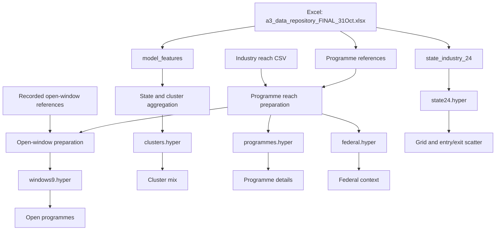

# Q3 data model and flow

The dashboard uses five independent prepared Hyper extracts. It does not use a live Excel connection or a connected Tableau relationship canvas.

| Extract | Rows | Grain | Candidate key |
|---|---:|---|---|
| state24 | 24 | State × industry | state + industry |
| clusters | 28 | State × observed cluster | state + cluster_name |
| programmes | 84 | Programme × industry | row_id + industry |
| windows9 | 9 | Programme in recorded open snapshot | row_id |
| federal | 3 | Federal summary × industry | industry |

The workbook definition contains calculations, charts, parameters, layout and relative extract connections. The packaged TWBX contains that definition and all five Hyper files. Shared parameters coordinate worksheets; they are not database joins.

Keeping the facts separate preserves each table’s grain and avoids multiplying SMB counts by programme or cluster rows. This is a snapshot pipeline: updates require deliberate data preparation and repackaging.
